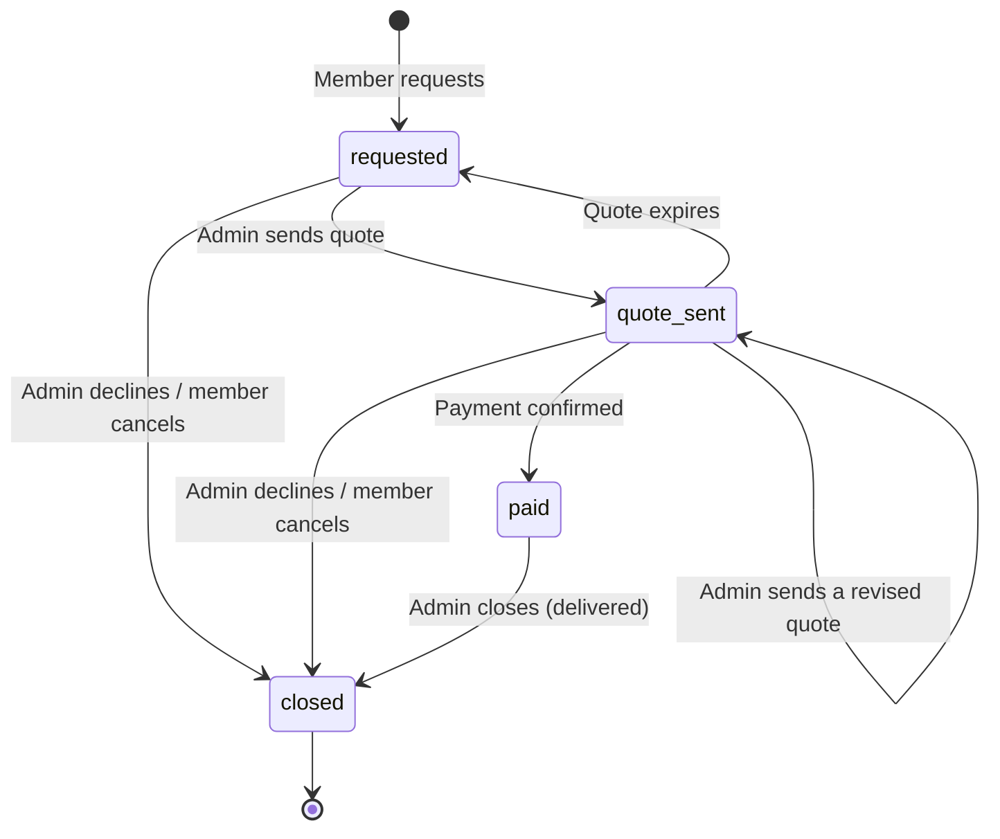
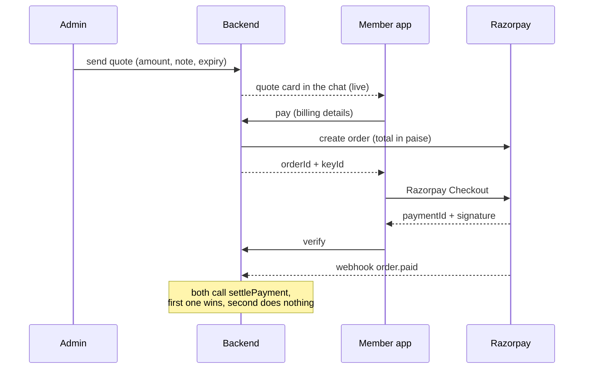

# Services Module: Plan

A member requests a **service** (for example portfolio management) from an admin. They chat to agree what is needed, the admin sends a **quote**, the member pays it through Razorpay, the admin delivers the service outside the app, and the admin closes the request. It reuses the support-ticket module's design: one admin owns each request, chat over the same WebSocket, community-scoped access.

Status: **plan for review, nothing is built yet.** Section 12 lists the few assumptions to confirm.

## 1. Scope

| In | Out (for now) |
|---|---|
| Admin-managed service catalog (name, title, description, image) | Refunds and credit notes (tables are designed so they can be added) |
| Member service request and chat (text and files) | Mobile screens (only the API and an integration doc) |
| Admin quote, payable through Razorpay (order plus verify plus webhook) | Delivering the service itself (it happens outside the platform) |
| GST added on top of the quote, automatic invoice with PDF | Push notifications and email beyond the invoice email |
| Admin close, member cancel, member rating | Payment splits to admins (all money goes to the platform) |
| Admin web UI: inbox, chat, send quote, catalog, billing settings | |

## 2. Decisions already made

| Topic | Decision |
|---|---|
| Money | All of it to the platform's Razorpay account |
| GST | Added on top of the quoted amount. Default 18%, configurable |
| Invoice | Automatic on payment. Number `FS/2026-27/0001`, unbroken sequence per financial year, PDF the member can download |
| Business details | Legal name, address, GSTIN and SAC code are entered by a super admin in the dashboard |
| Quote | Only an admin sends one. Default expiry 5 days, configurable |
| New quote | The old quote stays in the chat as a disabled card labelled "Replaced by a newer quote" |
| Admin access | Same as tickets: community scoped, claim, super admin reassigns |
| Closing | Admin closes after delivery. Member can cancel before paying. Member rates after it closes |
| Razorpay data | New separate tables (not `plan_orders`) that keep the history of orders, payments and webhook events |
| Payment confirmation | Both the client verify call and the webhook, each safe to run twice, each a fallback for the other |
| Refunds | Not in version 1 |

## 3. Lifecycle

| Status | Meaning | Chat |
|---|---|---|
| `requested` | Waiting for a quote (or the last one expired) | Open |
| `quote_sent` | One quote is active and payable | Open |
| `paid` | Payment confirmed, admin delivers the service | Open |
| `closed` | Final. `closedReason`: `completed`, `declined`, `cancelled_by_member` | Read-only |

Rules:

- **One owner.** The first admin to claim a request or reply becomes its assignee. Only that admin or a super admin can reply, quote or close (same rules as tickets).
- **One active quote.** Sending a new quote supersedes the current one in the same transaction.
- **Expiry returns the request to `requested`** (the four states you defined stay the only four). The sweep job marks the quote `expired` and logs an event.
- **Cancel:** the member can cancel in `requested` or `quote_sent`. Once `paid`, only the admin closes.
- **Rating:** only a `completed` request can be rated, once, like a ticket.
- **No reopen.**

## 4. Data model

All new tables, defined in `apps/backend/prisma/schema.prisma`. Money is `Decimal(12,2)` in rupees (the same convention as `Subscription.payment`) and is converted to paise only at the Razorpay boundary. Columns used for keyset paging (`lastMessageAt`, message `createdAt`) are `Timestamptz(3)` from day one.

### Catalog and requests

| Table | One row is | Key columns |
|---|---|---|
| `services` | A catalog item | `communityId`, `name` (internal), `title` (shown to members), `description`, `imageUrl`, `isActive`, `createdBy`, `deletedAt` |
| `service_requests` | One member request (the "ticket") | `number` (shown as `SR-n`), `userId`, `serviceId`, `communityId`, `status`, `closedReason`, `needs` (the member's description), `assignedAdminId`, `clientRequestId`, `userUnreadCount`, `adminUnreadCount`, `lastMessageAt`, `activeQuoteId`, `requiresReview`, `paidAt`, `closedAt`, `rating`, `ratingComment`, `ratedAt` |
| `service_messages` | A chat message | `requestId`, `senderId`, `senderRole`, `kind` (`text` / `quote` / `system`), `body`, `quoteId` (for quote cards), `clientMessageId`, `createdAt` |
| `service_attachments` | An uploaded file | like `ticket_attachments` |
| `service_events` | Audit trail | `created`, `assigned`, `reassigned`, `quote_sent`, `quote_superseded`, `quote_expired`, `paid`, `closed`, `cancelled`, `payment_flagged` |

Uniqueness gives the duplicate protection, as for tickets: `(userId, clientRequestId)` on requests and `(requestId, clientMessageId)` on messages.

### Quotes

`service_quotes`: `requestId`, `version`, `baseAmount`, `gstRatePercent`, `gstAmount`, `totalAmount`, `note`, `expiresAt`, `status` (`active`, `superseded`, `expired`, `paid`, `cancelled`), `billing` (the member's billing details, filled when they start paying), `createdBy`, `createdAt`. A partial unique index allows **one `active` quote per request**.

### Razorpay ledger (separate from `plan_orders`)

| Table | Purpose | Key columns |
|---|---|---|
| `razorpay_orders` | Every order we create | `razorpayOrderId` (unique), `purpose` (`service_quote`), `referenceId` (the quote id), `userId`, `amount`, `currency`, `status` (`created`, `paid`, `failed`), `receipt`, `notes`, `createdAt`, `paidAt` |
| `razorpay_payments` | Every payment attempt on those orders, including failures | `razorpayPaymentId` (unique), `razorpayOrderId`, `amount`, `status` (`authorized`, `captured`, `failed`), `method`, `settledVia` (`verify` or `webhook`, whichever won), `errorCode`, `errorDescription`, `raw` (JSON), `createdAt` |
| `razorpay_webhook_events` | Every webhook received | `razorpayEventId` (unique, from the `X-Razorpay-Event-Id` header), `eventType`, `payload`, `signatureValid`, `processedAt`, `processingError` |

`purpose` and `referenceId` make the ledger reusable by later features. `plan_orders` and the plan payment flow are untouched.

### Billing and invoices

| Table | Purpose |
|---|---|
| `billing_settings` | One row, edited by super admin: legal name, address, state, GSTIN, SAC code, default GST rate, default quote expiry days, invoice prefix |
| `invoice_counters` | One row per financial year with the last number used. Incremented inside the payment transaction, so the sequence has no gaps |
| `service_invoices` | One per paid quote: number, financial year, `issuedAt`, **snapshots** of seller and buyer, taxable value, CGST / SGST / IGST, total, `pdfObjectKey`. Snapshots mean later edits to settings never change an issued invoice |

## 5. Payment design

**`settlePayment(orderId, paymentId, source)`** is the single place a payment becomes real. It is called by both the verify endpoint and the webhook. In one database transaction it:

1. Moves the Razorpay order `created` to `paid` with a compare-and-swap, so a second caller affects zero rows and returns the existing result.
2. Records the payment row and which source settled it.
3. Moves the quote `active` to `paid` and the request `quote_sent` to `paid`.
4. Allocates the invoice number and writes the invoice row.
5. Writes the audit event and a system message ("Payment received") in the chat.

After the commit it publishes live events and queues two jobs: render and store the invoice PDF, and email it if the member has an email. Neither can fail the payment.

**Verify endpoint:** checks the order belongs to this member, checks the signature with the existing HMAC helper, then calls `settlePayment`.

**Webhook endpoint:** `POST /api/v1/payments/webhooks/razorpay`.

- Needs the **raw body** to check the `X-Razorpay-Signature` HMAC with a new `RAZORPAY_WEBHOOK_SECRET`. The app parses JSON globally today, so this one route captures the raw bytes before the parser.
- Stores the event (dedupe on the event id), calls `settlePayment` for `order.paid` / `payment.captured`, and records `payment.failed` rows.
- Always answers 200 quickly for events it ignores or has already seen; Razorpay retries non-200 responses for up to 24 hours.
- **Ignores orders that are not in `razorpay_orders`.** The Razorpay account also sends events for plan purchases; those must keep working untouched.

**Integrity checks** in both paths: the paid amount must equal the quote total, the currency must be INR, and the order must be the one currently linked to that quote.

**Edge cases:**

| Case | Behaviour |
|---|---|
| Member pays twice or taps pay twice | One order per quote is reused while unpaid and unexpired; a paid order cannot be paid again |
| Verify fails and the webhook arrives (or the reverse) | Whichever comes first settles it; the other is a no-op |
| Quote was replaced or expired, but money was captured anyway (member had Checkout open) | The payment is recorded, the request gets `requiresReview`, admins see a banner, and **no invoice is issued automatically**. With no refund feature in v1 a super admin refunds it manually in the Razorpay dashboard |
| Admin revises a quote while an order exists | The old order stays unpaid in Razorpay (orders cannot be edited or cancelled); locally the quote is `superseded` and its Pay button is disabled |
| Webhook secret missing or wrong | Events are stored with `signatureValid = false`, nothing is settled, the response is 400 |

An optional third safety net, a sweep that asks Razorpay for orders still `created` after 15 minutes, can be added later without schema changes.

## 6. GST and invoice

- **Quote maths:** the admin types the base amount. `gst = round(base x rate / 100, 2)` and `total = base + gst`. The total is what Razorpay charges. The default rate and any per-quote override both come from settings.
- **Place of supply:** the seller's state comes from `billing_settings`; the buyer's state is collected when the member starts paying (name, state, optional GSTIN). Same state: CGST plus SGST, each half of the GST. Different state: IGST. The total never changes, only the split.
- **Invoice number:** financial year runs April to March in IST. `FS/2026-27/0001`, taken from `invoice_counters` inside the payment transaction.
- **PDF:** rendered in the worker with `pdfkit` (pure JavaScript, no browser), stored in a private bucket (`MINIO_INVOICES_BUCKET`), and delivered through a short-lived signed link. Contents: seller details with GSTIN, invoice number and date, buyer details and state, description with SAC code, taxable value, tax split, total.
- Please have your accountant review the invoice layout and the SAC code. This plan is not tax advice.

## 7. API

Chat reuses the existing `/ws/tickets` connection with new actions (`service.message.send`, `service.history.get`, `service.read`) and events (`service.created`, `service.message`, `service.updated`, `service.read`), so the app keeps one socket.

**Member (`/api/v1/mobile/services`)**

| Method and path | Purpose |
|---|---|
| `GET /catalog` | Active services for the member's communities |
| `POST /attachments/presign` | Upload link for a file |
| `POST /` | Request a service (`Idempotency-Key`; body: `serviceId`, `needs`, attachments) |
| `GET /` , `GET /:id` , `GET /unread-count` | List, detail, badge |
| `POST /:id/cancel` | Cancel before payment |
| `POST /:id/quotes/:quoteId/pay` | Create the Razorpay order (billing details in the body). Returns `orderId`, `amount`, `currency`, `keyId` |
| `POST /:id/payments/verify` | Verify after Checkout |
| `GET /:id/invoice` | Signed link to the invoice PDF |
| `POST /:id/rating` | Rate a completed request |
| `GET /:id/attachments/:attachmentId/url` | Fresh file link |

**Admin (`/api/v1/admin/services`)**

| Method and path | Purpose |
|---|---|
| `GET /`, `GET /stats`, `GET /:id` | Inbox, counters, detail with audit timeline and payment info |
| `POST /:id/claim`, `POST /:id/reassign` | Same rules as tickets |
| `POST /:id/quotes` | Send a quote: `baseAmount`, `note`, optional `expiryDays`, optional `gstRatePercent` |
| `POST /:id/close` | Close with a reason (`completed` or `declined`) |
| `GET /:id/invoice`, `POST /attachments/presign`, `GET /:id/attachments/:attachmentId/url` | As above |
| `GET /catalog`, `POST /catalog`, `PATCH /catalog/:id`, `DELETE /catalog/:id`, `POST /catalog/image/presign` | Catalog management |
| `GET /billing-settings`, `PUT /billing-settings` | Super admin only |

**Payments (no auth, signed):** `POST /api/v1/payments/webhooks/razorpay`.

## 8. Admin web UI

New sidebar item "Services" with an attention badge (unassigned plus mine with unread), and these pages:

- **Services inbox** (`/admin/services`): same layout as Tickets, with the four statuses as filters and counters.
- **Request detail** (`/admin/services/[id]`): the chat, a **Send quote** panel (amount, live GST and total preview, note, expiry days), quote cards with their state, a payment and invoice panel, and Claim, Reassign and Close actions.
- **Catalog** (`/admin/services/catalog`): create and edit services with image upload.
- **Billing settings** (`/admin/settings/billing`, super admin): legal details, SAC, GST rate, expiry days.

## 9. Things this touches in existing code

- **Orphan upload cleanup.** The daily sweep I added for tickets deletes any `tickets/` upload no ticket references. Service files would be deleted after 24 hours unless the sweep also checks `service_attachments` (or services use their own prefix). Part of phase 1.
- **Raw body for the webhook:** a small change in `app.ts`.
- **New dependency:** `pdfkit` in the backend.
- **New environment values:** `RAZORPAY_WEBHOOK_SECRET`, `MINIO_INVOICES_BUCKET`, plus the webhook URL registered in the Razorpay dashboard with events `order.paid`, `payment.captured`, `payment.failed`.
- **Shared code:** cursor, attachment and upload helpers from the tickets module are reused rather than copied.

## 10. Build phases

| Phase | Content |
|---|---|
| 1 | Schema and migrations, catalog, request, claim / reassign / close / cancel, chat over the socket, attachments, upload-sweep fix |
| 2 | Billing settings, quotes (send, supersede, expire sweep), Razorpay ledger, pay / verify / webhook / `settlePayment`, invoice numbering and PDF, rating |
| 3 | Admin dashboard pages |
| 4 | Mobile integration guide (`docs/mobile-services-integration.md`) |

## 11. How it will be tested

As with the ticket module, against a real Postgres and Redis with the running backend:

- All state transitions and permission rules, quote supersede and expiry, duplicate requests and messages.
- **Payments with Razorpay mocked** (this environment cannot reach Razorpay): signatures are generated locally, so verify and webhook can each be fired first, both, twice, concurrently, and with a bad signature or the wrong amount. Plan-purchase payments must stay untouched.
- Invoice numbers under concurrent payments (unbroken, unique), GST split cases (same state, different state, odd paise).
- The admin UI in a real browser.
- Not testable here: the real Razorpay Checkout sheet and a real webhook delivery. Those need test-mode keys on staging, and I will list the exact steps.

## 12. Assumptions to confirm

1. **Catalog scope.** Each service belongs to **one community**, and a member sees services of communities they are subscribed to. Say so if you want them global instead.
2. **Name versus title.** `name` is the internal label for admins and `title` is what the member sees. If you only need one, I will drop the other.
3. **Catalog permissions.** Any admin with access to a community can manage that community's services; super admins manage all.
4. **Expiry resets the status** to `requested`, as in section 3.
5. **Late payments** on an expired or replaced quote are recorded and flagged for a manual refund, with no automatic invoice (section 5).
6. **Duplicate requests.** A member can have only one open request per service at a time, to prevent duplicates. Say so if you want to allow several.
7. **Regulatory.** Portfolio management is regulated by SEBI. I can add a consent or disclaimer step when requesting a service if you want one.
