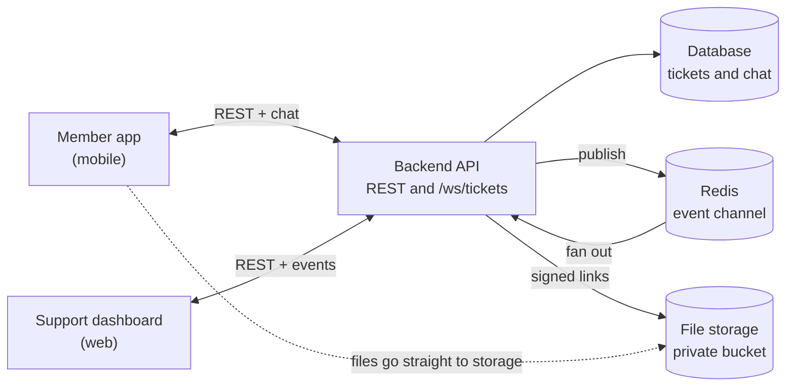
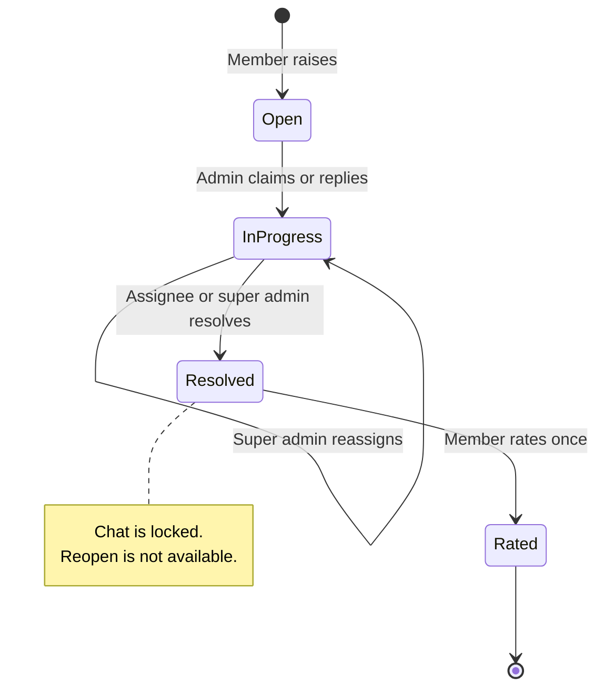
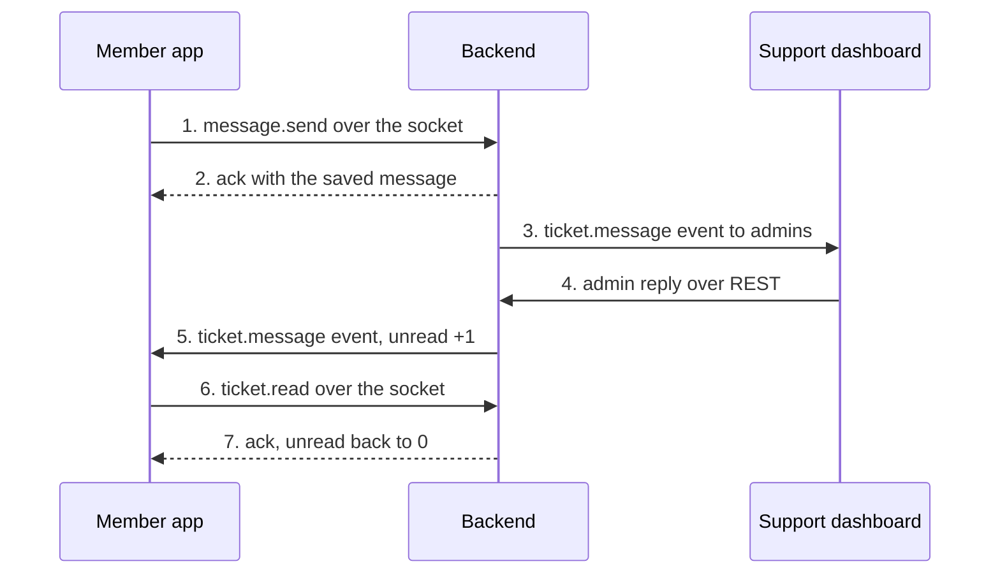

# Support Tickets: End-to-End Flow

How the support ticket module works from start to finish: what the member does in the mobile app, what the support team does in the admin dashboard, and what the backend does in between. Written from the code as of 2026-10-16.

Code lives in `apps/backend/src/modules/tickets/` (REST and business rules), `apps/backend/src/lib/live-tickets-feed.ts` (WebSocket) and `apps/frontend/src/app/admin/tickets/` (dashboard).

## At a glance

Members raise tickets in the mobile app and chat with the support team, who work in the web dashboard. Both talk to one backend, which stores tickets in the database, keeps files in private storage, and uses Redis to push live updates to whoever has a socket open.

The member app chats over the WebSocket and uses REST for tickets and uploads. The dashboard uses REST for everything and listens on the socket for updates. Files never pass through the backend: the app uploads straight to storage with a signed link the backend issues.

## Ticket lifecycle

A ticket moves from Open to In progress to Resolved, and only the support team moves it. The member raises it and, at the end, rates it.

A ticket becomes In progress when an admin claims it or sends the first reply, and stays In progress when a super admin reassigns it. Open and In progress both keep the chat open. Once Resolved, no more messages are accepted. The Figma design shows a "No, reopen ticket" button, but the backend has no reopen yet.

## Flow 1: raising a ticket

A member raises a ticket in one form submit. The ticket is created as Open, support is told within seconds, and a second tap or a retry cannot create a duplicate.

1. **Member opens My Tickets and taps "Raise a new ticket".** The app loads the member's communities (`GET /communities`): every community they hold or ever held a subscription for, free community included.
2. **Member fills the form.** Category, community, type, subject (up to 150 characters) and description (up to 2000). Files are optional.
3. **App uploads each file first.** For every file it asks the server for a one-time upload URL (`POST /attachments/presign`), then sends the file straight to private storage. Only the storage keys travel with the ticket.
4. **Member taps Submit.** The app sends `POST /` with an `Idempotency-Key` header, one new value per form.
5. **Server checks, in order:**
    - a ticket with this key already exists for this member: return it (no new ticket)
    - the account is active, not deleted or suspended (otherwise `ACCOUNT_INACTIVE`)
    - the community is one of the member's (otherwise `COMMUNITY_NOT_ALLOWED`)
    - every attachment key belongs to this member, is 5 MB or less and is a real JPG, PNG, WebP or PDF (otherwise `ATTACHMENT_INVALID`)
6. **Server saves, in one transaction:** the ticket with status Open and the support unread count set to 1, its attachments, and a `created` entry in the ticket's audit trail. If two identical submits race, the second hits the unique key and gets the first one's ticket back.
7. **Server announces it.** A `ticket.created` event goes to every admin who can see that community (all super admins plus admins granted that community) and to the member's own sockets, so a second device updates too.
8. **App shows "Ticket submitted"** from the response and offers "View ticket".

**What the ticket looks like now:** status Open, nobody assigned, support unread count 1, member unread count 0, `lastMessageAt` set to creation time.

All member endpoints are under `/api/v1/mobile/tickets`.

### Attachment rules

| Rule | Value |
|---|---|
| Types | JPG, JPEG, PNG, WebP, PDF |
| Size | 5 MB per file |
| Count | 5 per ticket description, 5 per chat message |
| Check | The server reads the file's first bytes, so a renamed file fails |
| Storage | Private bucket. Files are only reachable through short-lived signed links (about 5 minutes) |

## Flow 2: the chat

Every message is saved first and pushed second, so a lost push never loses a message. The member sends and reads over the socket, and support sends over REST.

Steps 3 and 5 are the same `ticket.message` event, fired once for each direction. The member's own device also gets the step 1 message back as an event, so the app skips ids it already shows.

- **Saving a message** updates the ticket's last activity time and adds 1 to the other side's unread count.
- **A member can write on an Open ticket** before any admin replied. Support sees it as unread.
- **A message needs text, a file, or both.** Text is up to 2000 characters and files up to 5.
- **History** comes newest first, 30 per page (up to 100), paged by a cursor so new messages never shift older pages.
- **A resolved ticket refuses messages** from both sides.

## Flow 3: the support team handles it

One admin owns each ticket. The first admin to claim it or reply to it becomes its assignee, and from then on only that admin (or a super admin) can reply or resolve. Support works in the web dashboard at `/admin/tickets` and talks to the server over REST (`/api/v1/admin/tickets`); it receives live updates on the same WebSocket the members use.

1. **A new ticket appears in the inbox.** The `ticket.created` event adds it live, with an unread badge. Admins only see tickets of communities they have access to. Super admins see all.
2. **The inbox can be filtered and searched** by status, category, type, community, assignee (me, unassigned, or a named admin) and unread. Search matches the subject, the ticket number (`FS-2041` or `2041`) and the member's name. Header numbers show unassigned, mine, mine unread, in progress, resolved and the average rating.
3. **Admin opens the ticket** and sees the description, attachments, the chat and an audit timeline of who assigned and resolved it.
4. **Admin claims it** (the Take button) or simply replies. Either one atomically assigns the ticket to them and moves it from Open to In progress. If another admin got there first, a claim fails with `TICKET_ALREADY_ASSIGNED`, and a reply with `TICKET_ASSIGNED_TO_OTHER`.
5. **Admin replies.** Text, up to 5 files, and a `clientMessageId` so a retry cannot double-post. The member's unread count goes up by 1 and the member's app receives the message live.
6. **Admin clears the unread badge** by opening the ticket (`/read`). Only the assignee clears it, so a colleague browsing the ticket does not hide it from the owner.
7. **A super admin can reassign.** The new owner must have access to the ticket's community (otherwise `ADMIN_NOT_ELIGIBLE`). The ticket stays or becomes In progress and the audit trail records who handed it to whom.
8. **The assignee resolves it** (see the next flow).

### Who can do what to an open ticket

| Admin | Read | Claim | Reply | Resolve | Reassign |
|---|---|---|---|---|---|
| Has community access, ticket unassigned | Yes | Yes | Yes (reply claims it) | Must claim first | No |
| Has community access, is the assignee | Yes | Already theirs | Yes | Yes | No |
| Has community access, another admin owns it | Yes | No | No | No | No |
| Super admin | Yes | Yes | Yes | Yes | Yes |
| No access to the community | No (404) | No | No | No | No |

## Flow 4: resolving and rating

Resolving closes the ticket for good: the chat locks, nothing reopens it, and the member's only remaining action is a one-time rating.

1. **The assignee (or a super admin) clicks Resolve.** An unassigned ticket must be claimed first, unless the admin is a super admin.
2. **Server resolves it atomically.** Status becomes Resolved, `resolvedAt` is set, the support unread count is zeroed, and a `resolved` entry is added to the audit trail. The member's own unread count is left alone, because they may not have seen the last reply yet.
3. **Member's app is told.** A `ticket.updated` event reaches the member (and the community's admins). If the member is on the conversation, the composer locks and the rating sheet opens.
4. **Further chat is refused.** A message from either side returns `TICKET_RESOLVED`. This holds even if a send was already in flight when the resolve landed, because the status check is part of the same database write.
5. **Member rates once.** One to five stars and an optional comment of up to 1000 characters, on a resolved ticket only. The write only succeeds if the ticket is resolved and has no rating yet, so two fast taps cannot both save. A second attempt gets `ALREADY_RATED`.
6. **Support sees the rating.** The community's admins receive a `ticket.updated` event, and the dashboard's average rating and rating count update.

### What changes when a ticket is resolved

| | Before | After |
|---|---|---|
| Member can chat | Yes | No |
| Support can reply | Assignee or super admin | No |
| Reassign | Super admin | No |
| Rating | Not allowed | Once, final |
| Reopen | Not available | Not available |

## Realtime delivery

Every change reaches the right people through one WebSocket endpoint, `/ws/tickets`, which both the mobile app and the web dashboard connect to. Each change is published once, and the server pushes it to every open socket of every person who should see it.

| What happens | Event | Who receives it |
|---|---|---|
| Member raises a ticket | `ticket.created` | The community's admins, and the member's own sockets |
| Member sends a message | `ticket.message` | The community's admins, and the member's own sockets (the sending device too) |
| Admin replies | `ticket.message` | The member, and the community's admins |
| Admin claims, reassigns or resolves | `ticket.updated` | The member, and the community's admins |
| Member rates | `ticket.updated` | The community's admins only |
| Member opens the ticket and clears unread | `ticket.read` | The member's other devices |
| Admin clears unread | `ticket.read` | That admin's other tabs |

"The community's admins" means every super admin plus every admin granted access to that community.

### How it is delivered

1. The service finishes its database write, then publishes `{ audience, event, ticketId, data }` to a Redis channel (`tickets:live`). A failed publish is logged and never fails the request.
2. Every API server instance listens on that channel. The instance that holds a recipient's socket sends them the event, so scaling to several instances needs no sticky routing.
3. The audience list is removed before the event reaches the client.
4. Events carry a short ticket summary (id, label, subject, status, assignee, unread count, last activity, rating, resolved time) with each recipient's own unread count. They do not carry per-viewer permissions, so a dashboard re-asks the server whether it can reply or resolve.

### What the sockets can and cannot do

| | Mobile socket | Web admin socket |
|---|---|---|
| Receive events | Yes | Yes |
| Send chat message | Yes (`message.send`) | No, admins use REST |
| Load history | Yes (`history.get`) | No, REST |
| Clear unread | Yes (`ticket.read`) | No, REST |

Member requests use the frame `{ id, action, payload }` and get exactly one `{ event: "ack", id, ok, data | error }` back. The handler is in `apps/backend/src/modules/tickets/tickets.socket.ts`.

### Guarantees

- **Authentication:** the socket upgrade needs the member's `mobile_session_id` cookie or the admin's `access_token` cookie. Otherwise it is refused with 401.
- **Heartbeat:** the server pings every 30 seconds and drops silent connections, which matters on mobile networks.
- **Limits:** frames up to 64 KB, and 30 request frames per 10 seconds per connection.
- **No replay:** an event sent while a client is offline is lost. After a reconnect or when the app returns to the foreground, clients refetch the list, the unread total and the open conversation.
- **Duplicate handling:** a member's own message arrives as both the reply to their request and a `ticket.message` event. Clients skip a message whose id they already show.

## Rules and permissions

The module follows three principles: a ticket belongs to one member and one community, one admin owns it at a time, and nothing is allowed to leak by guessing an id.

| Rule | How it works |
|---|---|
| Members raise tickets from the mobile app only | The member endpoints accept only a mobile session. A web login is refused with `MOBILE_ONLY`. |
| A member sees only their own tickets | Every member query is filtered by the member's id. Another member's ticket answers 404, never 403, so ids cannot be probed. |
| A ticket is raised against a community the member holds or held | Any subscription row counts, free community included, so a lapsed renewal can still be raised. A deleted community is excluded. |
| Only active accounts can raise tickets | Deleted or suspended accounts get `ACCOUNT_INACTIVE`. |
| Admins see tickets of their communities | Super admins see all. Other admins see only communities they were granted. Anything else answers 404. |
| One admin owns a ticket | First claim or reply wins. Others can read but not act, except a super admin. |
| Only a super admin reassigns | And only to an admin who has access to that community. |
| Resolved is final | No messages from either side, no reassign, no reopen. Only the member's one-time rating can still be written. |
| No duplicates | A ticket needs a fresh `Idempotency-Key`. A message needs a `clientMessageId`. A repeat returns the original. |
| Files are private | Stored in a private bucket, keyed by the uploader's id, and only reachable through signed links that expire in about 5 minutes. |
| Limits | Subject 150 characters, description and messages 2000, rating comment 1000, 5 files of 5 MB each per ticket or message. |

### Race conditions the server already handles

- **Two taps on Submit:** the second returns the first ticket.
- **A reply sent as support resolves:** the write only succeeds on an unresolved ticket, so the message is refused rather than slipping into a closed ticket.
- **Two admins claim at once:** the claim is a single conditional update. One wins and the other gets `TICKET_ALREADY_ASSIGNED`.
- **Two rating taps:** only a resolved, unrated ticket accepts the write.

## Data model

Four tables hold everything (defined in `apps/backend/prisma/schema.prisma`). The ticket row carries the counters the inbox and the app badge read, so lists never have to count messages.

| Table | One row is | Key fields |
|---|---|---|
| `tickets` | One support request | `number` (shown as FS-number), `userId`, `communityId`, `category`, `type`, `subject`, `description`, `status` (open, in_progress, resolved), `assignedAdminId`, `clientRequestId`, `userUnreadCount`, `adminUnreadCount`, `lastMessageAt`, `rating`, `ratingComment`, `ratedAt`, `resolvedAt` |
| `ticket_messages` | One chat message | `ticketId`, `senderId`, `senderRole` (user or admin), `body` (empty for file-only), `clientMessageId`, `createdAt` |
| `ticket_attachments` | One uploaded file | `ticketId`, `messageId` (empty = attached to the description), `objectKey`, `fileName`, `mimeType`, `sizeBytes` |
| `ticket_events` | One audit entry | `ticketId`, `type` (created, assigned, reassigned, resolved), `actorId`, `meta` (who it went to and from), `createdAt` |

### Enums

| Field | Values |
|---|---|
| Category | payments, subscription, account, content, app_bug, other |
| Type | issue, question, feature_request, refund_request |
| Status | open, in_progress, resolved |

### Why it is built this way

- **Two unread counters.** Each side has its own count, raised when the other side writes and zeroed when it reads. The inbox filter, the sidebar badge and the app badge are single column reads.
- **Uniqueness does the duplicate protection.** `(userId, clientRequestId)` is unique on tickets, and `(ticketId, clientMessageId)` is unique on messages. A retry hits the key and returns the existing row.
- **Paging is stable.** Lists and history use a cursor on `(timestamp, id)`, so new activity at the top never shifts or repeats rows.
- **Attachments are rows, files live elsewhere.** The database stores the storage key, never a public address.
- **The audit trail is separate.** Chat messages stay clean, and the dashboard timeline comes from `ticket_events`. The member app does not receive these events yet.

## Gaps and open decisions

The module works end to end for raise, chat, claim, resolve and rate. These places still need a decision or a build.

| # | Gap | Today | Decision needed |
|---|---|---|---|
| 1 | Reopen | Figma has "No, reopen ticket". Resolved is final in the backend. | Build reopen, drop the button, or open a new prefilled ticket |
| 2 | "Yes, close ticket" | Only support resolves. The member can only rate. | Rename the button to a rating action, or add member-side close |
| 3 | Status dates and chat pills | The member gets `createdAt` and `resolvedAt` only. The audit trail is admin-only. | Expose when it went In progress and status events to members |
| 4 | Filter counts | The member list has no totals for "Open (1)" and the other chips. | Add a counts endpoint, or show chips without numbers |
| 5 | Email and push | None. Replies reach a member only over an open socket. | Add push and email, or remove the promise from the footer |
| 6 | Form fields | The design omits `type`, calls the community optional (the API requires it) and shows a 500-character counter (the API allows 2000). | Align design and API |
| 7 | Old chat endpoints | Member send, history and read still exist over REST next to the socket versions. | Keep as a fallback or remove |
| 8 | Real-socket test | The member socket requests were checked against a fake service, not a live connection. | Test on a real device before release |

## Doubts and answers

Questions raised while reviewing this flow, each answered from the code.

### 1. How does an admin get tied to a ticket, and who does each chat message belong to?

**Doubt:** A chat has two people in it. How do we know who sent which message, and how is the admin connected to the ticket?

**Answer:** The ticket stores the two people once. Each message stores only its sender.

| Where | Holds | Meaning |
|---|---|---|
| `tickets.userId` | Member id | The member who raised the ticket. Never changes. |
| `tickets.assignedAdminId` | Admin id, or empty | The one admin responsible right now. Empty until someone claims or replies. Can change. |
| `ticket_messages.senderId` | User id | Who wrote this message: the member or one specific admin. |
| `ticket_messages.senderRole` | `user` or `admin` | Which side wrote it. |
| `ticket_events` | Audit row | Every assign, reassign and resolve, with who did it and who it went to. |

There is no "recipient" column. The other side is always read from the ticket: a member's message is for the assigned admin (every admin of that community can see it), and an admin's message is for `tickets.userId`.

Because each message keeps its own sender id, the history stays correct when the owner changes. If Admin A answers and the ticket then moves to Admin B, A's earlier messages still show A and B's later ones show B.

An admin gets tied to a ticket at one of three moments. Each one sets `assignedAdminId`, moves the status to In progress and writes an audit row:

1. The admin clicks **Take** (claim).
2. The admin sends the first reply on an unassigned ticket. The reply claims it automatically.
3. A super admin **reassigns** it.

### 2. How does assignment work, and what happens to the first admin when a super admin reassigns?

**Doubt:** When a super admin gives a ticket to another admin, what happens to the admin who started it?

**Answer:** The ticket has exactly one owner at a time. A reassign swaps the owner in one step, and the previous owner immediately loses the right to act but keeps the history.

| Ticket state | Who can reply and resolve | Who can change the owner |
|---|---|---|
| Unassigned (Open) | Any admin with access to the community. A reply or a Take claims it. | Anyone with access, by claiming |
| Assigned (In progress) | The owner, and any super admin | A super admin, by reassigning |
| Resolved | Nobody | Nobody |

**When a super admin moves a ticket from Admin A to Admin B:**

1. The server checks that the caller is a super admin, the ticket is not resolved, and B is an admin with access to the ticket's community.
2. In one database write, the ticket's owner becomes B and the status is set to In progress. An audit row `reassigned` records "from A, to B".
3. Everyone who can see the ticket gets a live `ticket.updated`: both admins, the community's other admins, and the member. The member's app now shows B's name.

**What changes for Admin A:**

- A can no longer reply or resolve. Any attempt is refused with `TICKET_ASSIGNED_TO_OTHER`, and the dashboard turns those buttons off.
- A reply sent at the same instant as the reassign cannot slip through, because the owner is checked inside the same write that saves the message.
- A can still read the ticket, as long as A has access to the community.
- A's earlier messages stay under A's name.
- The ticket leaves A's "mine" count and joins B's.

**What B inherits:** the support unread count. It is one counter for the whole ticket, not one per admin, so it keeps its value until the owner opens the ticket. Only the owner can clear it.

**Not covered today:**

- An admin cannot hand a ticket back to "unassigned". Only a super admin can reassign it, and only to another admin.
- B is told only through the live dashboard event. There is no push or email, so B notices only if the dashboard is open or when they next view their list.
- If an admin's account is deleted, the ticket's owner becomes empty but the status stays In progress. Any admin with access can then claim it again.
- The member's chat shows no "assigned to B" line, only the new support name on the ticket.

### 3. What does "load the member's communities" mean (Flow 1, step 1)?

**Doubt:** The app calls `GET /communities` when the member taps Raise a new ticket. What is that list and why is it needed?

**Answer:** A ticket must belong to a community, because the community decides which admins see it. The list is the set of communities the member is allowed to raise a ticket against, and it feeds the "Related subscription" dropdown.

- **What is in it:** every community where the member has any subscription record. That includes active, expired and cancelled subscriptions, and the free community. A deleted community is left out.
- **Why include lapsed ones:** payment and renewal problems often come after a subscription has ended, and the member should still be able to raise them.
- **What it returns:** `id`, `name` and `isFree` for each community, sorted by name.
- **The server does not trust the dropdown.** On submit it checks again that the member has a subscription row for the chosen community. A community that is not theirs is refused with `COMMUNITY_NOT_ALLOWED`.
- **A member with no communities** gets an empty list and cannot submit.
- **Design mismatch:** Figma marks "Related subscription" optional, but the API requires it.

### 4. What does "saves in one transaction" mean, and what happens on a double submit (Flow 1, step 6)?

**Doubt:** The ticket, its files and an audit entry are saved "in one transaction", and a race returns the first ticket. What does that mean?

**Answer:** A transaction is an all-or-nothing database write. Either the ticket, its attachments and its audit entry are all saved, or none of them is. You can never end up with a ticket that has no audit entry, or files pointing at a ticket that does not exist.

**What is saved together:**

| Row | Contents |
|---|---|
| Ticket | Status Open, nobody assigned, support unread count 1, member unread count 0, the next FS number, the `Idempotency-Key` stored as `clientRequestId`, last activity set to now |
| Attachments | One row per file, with no message id, which marks them as attached to the description |
| Audit entry | Type `created`, with the member as the actor |

The checks (active account, allowed community, valid files) run **before** the transaction, so a bad file means no ticket at all. The live `ticket.created` event is sent **after** the transaction commits, so no one is ever told about a ticket that was not saved.

**The double-submit race:**

1. The member taps Submit twice quickly, or the app retries after a timeout. Both requests carry the same `Idempotency-Key`.
2. Both first look for an existing ticket with that key and, finding none, both try to save.
3. The database allows only one ticket per member and key. The first save wins.
4. The second save fails with a duplicate-key error. The server catches it, looks up the winner's ticket and returns it as its own answer.
5. Both requests receive the same ticket. The app cannot tell which one did the work, and only one ticket exists.

This is why the app must reuse the key on a retry and create a new key for each new form.
